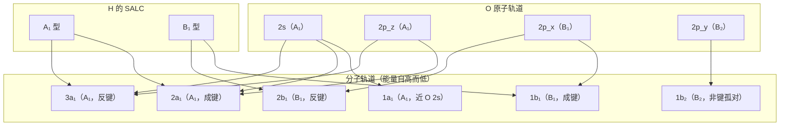

---
tags:
  - 群论
  - 结构化学
Category:
  - 笔记
---
# 群论应用三步法

## 介绍

<mark style="background: #ADCCFFA6;">群论应用三步法</mark>：把点群用于化学问题的固定流程，依次为选基、约化、解释。

$$
\begin{aligned}
&\text{i. 选基：基}\longrightarrow\text{点群的可约表示 }\Gamma\\ \\
&\text{ii. 约化：}\Gamma=\sum_i a_i\Gamma_i\\ \\
&\text{iii. 解释：}\Gamma_i\longrightarrow\text{轨道、键}
\end{aligned}
$$

$\Gamma$ ：基在点群全部操作下的表示，一般为可约表示，无单位
$\Gamma_i$ ：第 $i$ 个不可约表示
$a_i$ ：$\Gamma_i$ 在 $\Gamma$ 中出现的次数，非负整数
$h$ ：点群的阶，即群中对称操作的总数

三步的顺序不能反：基决定问题问的是哪组键或轨道，后两步按公式走。

## 3个步骤

### 1. 选基

基取矢量组或轨道组，须与所问的化学问题对应。基按点群的操作变换，判定见 [[01-分子点群分类]]。

可约表示的维数等于基函数的个数：
$$\Gamma(E)=\text{基函数的个数}$$

特征标由每个操作下各基函数的变换给出：
$$
\chi(R)=\sum_{\text{基函数}}\begin{cases}+1 & \text{留在原位，方向不变}\\  \\ -1 & \text{留在原位，方向反转}\\ \\ 0 & \text{离开原位} \\
\end{cases}
$$

### 2. 约化

$$\begin{aligned}
\Gamma&=\sum_i a_i\Gamma_i\\
a_i&=\frac{1}{h}\sum_{R}N_R\,\chi_R\,\chi_i
\end{aligned}$$

$N_R$ ：第 $R$ 类操作所含的对称操作数
$\chi_R$ ：可约表示在第 $R$ 类操作上的特征标
$\chi_i$ ：不可约表示 $\Gamma_i$ 在同一类操作上的特征标

计算所得 $a_i$ 应为非负整数，且 $\sum_i a_i\chi_i(E)=\Gamma(E)$。

### 3. 解释

两个基函数能混合的必要条件是属同一不可约表示。

约化结果 $\Gamma=\sum_i a_i\Gamma_i$ 中的系数 $a_i$ 直接决定哪些对称性允许出现：

- **$a_i\neq0$**：存在一组基函数的线性组合（SALC），按 $\Gamma_i$ 的对称性变换，即这种对称性的组合是真实可取的喵。
- **$a_i=0$**：基函数无论怎么组合都凑不出该对称性，对称性判据把这种组合排除掉了。

## 四种应用

| 应用 | 基 | 第三步读出的结果 |
| --- | --- | --- |
| 杂化轨道 | 指向配体的键矢量 | 参与杂化的原子轨道 |
| π 键 | 垂直于分子平面的箭头，每对成键原子两个 | 能形成 π 键的轨道组合 |
| LCAO 分子轨道 | 各原子的价轨道 | 各分子轨道的对称性 |
| MO 相关图 | 中心原子轨道与配体轨道组合 | 同对称性轨道的连线 |

前三项按三步走完。相关图的构造多出一步：三步只给出两侧轨道各自的对称性，连线另按能量高低排序。

## 例题

### 例题 1：NH₃ 的 LCAO-MO（$C_{3v}$）

本例题对应四种应用中的 <mark style="background: #ADCCFFA6;">LCAO 分子轨道</mark>（基取各原子的价轨道）。

**① 选基**：H 的 3 个 1s 轨道作基。N 的轨道不放入可约表示，直接按 $C_{3v}$ 特征标表归属：2s、2p_z → $A_1$；$(2p_x,2p_y)$ → $E$。

$$\Gamma_H=(3,0,1)$$

即 $E$ 下 3、$2C_3$ 下 0、$3\sigma_v$ 下 1。

**② 约化**（$h=6$）：

$$\begin{aligned}
a(A_1)&=\frac{1}{6}\left[3\cdot1+2\cdot0\cdot1+3\cdot1\cdot1\right]=\frac{1}{6}(3+0+3)=1\\
a(A_2)&=\frac{1}{6}\left[3\cdot1+2\cdot0\cdot1+3\cdot1\cdot(-1)\right]=\frac{1}{6}(3-3)=0\\
a(E)&=\frac{1}{6}\left[3\cdot2+2\cdot0\cdot(-1)+3\cdot1\cdot0\right]=\frac{1}{6}(6)=1
\end{aligned}$$

$$\Gamma_H=A_1+E$$

回代校验：$\sum_i a_i\chi_i(E)=1\cdot1+1\cdot2=3=\Gamma(E)$ ✓

**③ 解释**：
- N 的 2s、$2p_z$（$A_1$）与 H 的 $A_1$ 型 SALC 组合出 3 个 $A_1$ 型 MO：低能 $1a_1$ 由 N 的 2s 主导、$2a_1$ 近孤对、$3a_1$ 反键。
- N 的 $(2p_x,2p_y)$（$E$）与 H 的 $E$ 型 SALC 组合出简并的 $1e$（成键）与 $2e$（反键）。
- NH₃ 共 8 个价电子，填 $1a_1^2\,2a_1^2\,1e^4$。

### 例题 2：H₂O 的 MO 相关图（$C_{2v}$）

本例题对应四种应用中的 <mark style="background: #ADCCFFA6;">MO 相关图</mark>（中心原子轨道与配体轨道组合，三步只给出两侧对称性，连线另按能量排序）。

**① 选基**：H 的 2 个 1s 轨道作基。

$$\Gamma_H=(2,0,2,0)$$

即 $E$ 下 2、$C_2$ 下 0、$\sigma_v(xz)$ 下 2、$\sigma_v'(yz)$ 下 0。

**② 约化**（$h=4$）：

$$\begin{aligned}
a(A_1)&=\frac{1}{4}\left[2\cdot1+0\cdot1+2\cdot1+0\cdot1\right]=1\\ \\
a(A_2)&=\frac{1}{4}\left[2\cdot1+0\cdot1+2\cdot(-1)+0\cdot(-1)\right]=0\\ \\
a(B_1)&=\frac{1}{4}\left[2\cdot1+0\cdot(-1)+2\cdot1+0\cdot(-1)\right]=1\\ \\
a(B_2)&=\frac{1}{4}\left[2\cdot1+0\cdot(-1)+2\cdot(-1)+0\cdot1\right]=0
\end{aligned}$$

$$\Gamma_H=A_1+B_1$$

**③ 解释**：O 的轨道归属：2s、2p_z → $A_1$；2p_x → $B_1$；2p_y → $B_2$（非键孤对）。$A_1$ 型：$1a_1$（近 O 2s）、$2a_1$（成键）、$3a_1$（反键）；$B_1$ 型：$1b_1$（成键）、$2b_1$（反键）；$B_2$ 型：$1b_2$（纯 O 2p_y 孤对）。8 个价电子填 $1a_1^2\,2a_1^2\,1b_1^2\,1b_2^2$。

相关图（连线只按同对称性匹配，能级高低另由能量决定）：

### 例题 3：CH₄ 的杂化轨道（$T_d$）

本例题对应四种应用中的 <mark style="background: #ADCCFFA6;">杂化轨道</mark>（基取指向配体的键矢量）。

以一组等价键为基，操作的特征标等于未被移动的键数：
$$
\chi(g)=\#\{\text{留在原位的键}\}
$$

$CH_4$ 的四个 $C-H$ 键：

| 操作 | $E$ | $C_3$ | $C_2$ | $S_4$ | $\sigma_d$ |
| --- | --- | --- | --- | --- | --- |
| 未移动键数 | 4 | 1 | 0 | 0 | 2 |

$C_3$ 绕某一根键旋转，只有该键不动；$C_2$ 与 $S_4$ 的轴不沿键，无键保留；每个 $\sigma_d$ 面含两根键。

$T_d$ 的阶 $h=24=1+8+3+6+6$。以四个 $C-H$ 键为基得四维表示 $\Gamma_4$，与 $T_d$ 特征标表对照如下：

| $T_d$ | $E$ | $8C_3$ | $3C_2$ | $6S_4$ | $6\sigma_d$ |
| --- | --- | --- | --- | --- | --- |
| $A_1$ | 1 | 1 | 1 | 1 | 1 |
| $A_2$ | 1 | 1 | 1 | −1 | −1 |
| $E$ | 2 | −1 | 2 | 0 | 0 |
| $T_1$ | 3 | 0 | −1 | 1 | −1 |
| $T_2$ | 3 | 0 | −1 | −1 | 1 |
| $\Gamma_4$ | 4 | 1 | 0 | 0 | 2 |

$\Gamma_4$ 不在 $T_d$ 的不可约表示表中，是可约表示：

$$
\Gamma_4=A_1+T_2
$$

核对：$A_1$ 与 $T_2$ 两行逐列相加得 $4,1,0,0,2$，与 $\Gamma_4$ 相同。

$s$ 轨道球对称，属 $A_1$；$p_x$、$p_y$、$p_z$ 属 $T_2$。$s$ 与三个 $p$ 张成的表示即 $\Gamma_4=A_1+T_2$，可组合出四个等价杂化轨道，指向四面体四个顶点，即 $sp^3$。

$d_{xy}$、$d_{xz}$、$d_{yz}$ 同属 $T_2$，$sd^3$ 给出同一个 $\Gamma_4$，仅凭对称性不能区分 $sp^3$ 与 $sd^3$。判断哪一个成立需进一步计算：$CH_4$ 中 $sp^3$ 更合适，$MnO_4^-$ 中 $sd^3$ 更合适。

## 适用条件

- 点群已判定，有所需特征标表。
- 基需要覆盖所研究的全部键或轨道；基中漏掉的对象不出现在任何不可约表示里。
- 方法只判定对称性允许与否；混合强弱取决于重叠积分与能量差，混合系数与轨道能量不在判定范围内。

